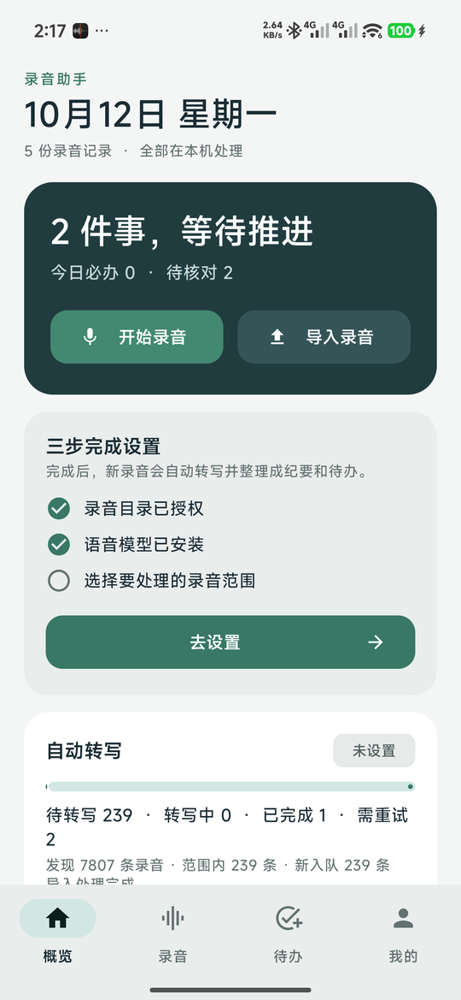
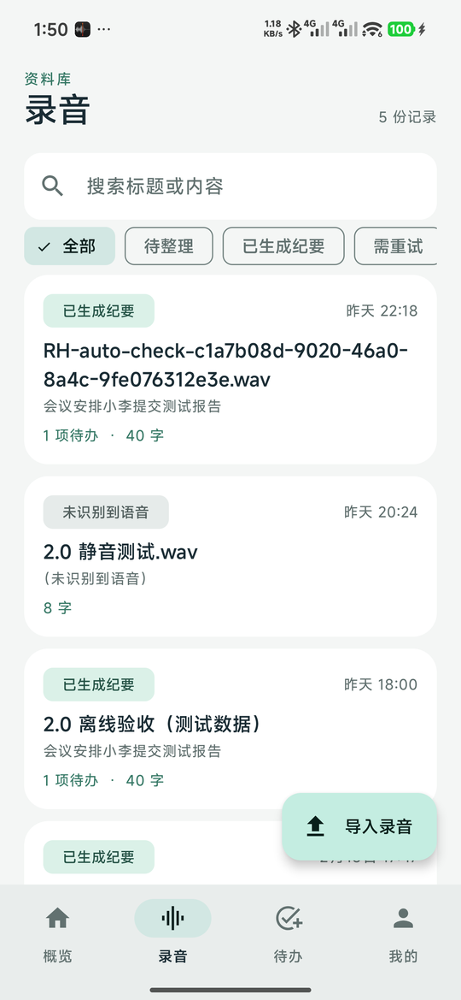
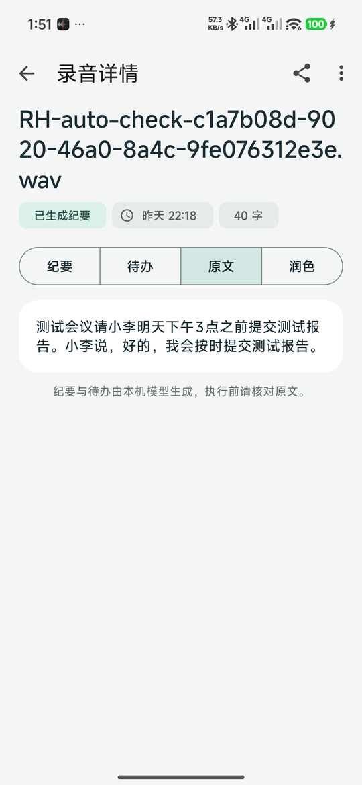
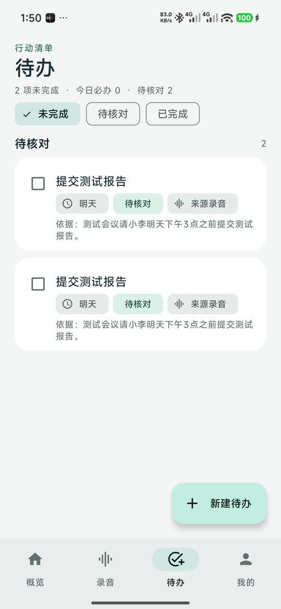
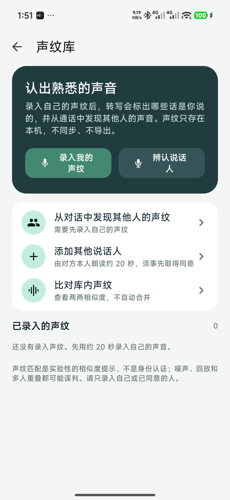
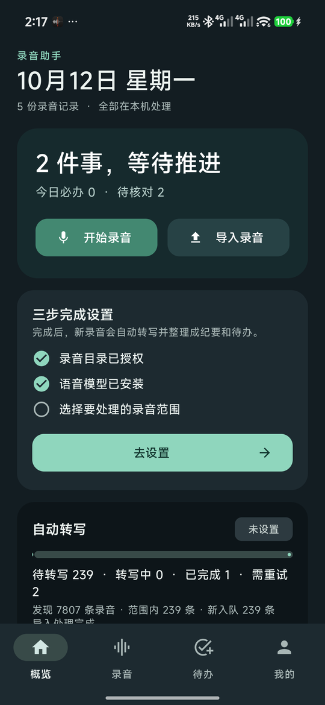

# 录音助手 Recording Helper

把手机上的通话和会议录音，在手机本机变成可核对的文字、纪要和待办。
不需要账号，不需要服务器，音频不离开手机。想在多台设备上看同一份待办时，可以自己部署一个只同步文字的小服务。

<p align="center">
  
  
  
  
</p>
<p align="center">
  
  
</p>

## 它做什么

1. **自动读取系统录音**：授权录音目录后，新的通话 / 会议录音会自动进入队列。处理哪些历史录音由你第一次明确选择。
2. **本机转文字**：SenseVoice-Small 在手机上运行，支持 CPU 与联发科 / 高通 NPU。可选的声纹模型能区分说话人。
3. **本机生成纪要和待办**：Qwen3.5-4B（GGUF）在充电时整理。每条待办都附带原文句子作为依据，对不上原文的待办会被丢弃。
4. **应用内录音**：边录边出分段文字；录入自己的声纹后，能标出哪些话是你说的。
5. **跨录音认出对方**：电话里通常只有你和另一个人，以你的声纹为锚点，多段通话里就能找出同一个对方，试听确认后命名入库。
6. **可选多设备同步**：自托管的 Node.js 服务只接收文字、纪要和待办，浏览器看板随时查看；删除也会同步。

完整功能清单与状态见 [docs/FEATURES.md](docs/FEATURES.md)。

## 安装

- 下载 [Releases](../../releases) 中的 APK（arm64，Android 8.0 以上；`snapdragon` 版额外包含高通 NPU 运行库）。
- 首次打开按首页的三步引导：授权录音目录 → 导入模型 → 选择处理范围。
- 模型文件的来源、哈希与转换方法见 [docs/MODELS.md](docs/MODELS.md)。应用不内置模型权重。

已在 Redmi（HyperOS 16）与 OPPO Find X9 Pro（ColorOS 17）真机验证。HONOR / vivo 已内置候选录音路径，尚未真机验证；任何机型都可以通过授权实际目录使用。

## 多设备同步（可选）

```sh
export RH_TOKEN="$(node -e "console.log(require('crypto').randomBytes(24).toString('base64url'))")"
node server/index.js            # 监听 127.0.0.1:8788，前面放一个 HTTPS 反向代理
```

手机端「设置 → 多设备同步」填入 HTTPS 地址和密钥。Docker、nginx、Caddy、systemd 模板在 `deploy/`，细节见 [server/README.md](server/README.md)。

## 构建

Android：JDK 17、Android SDK 35、Gradle 8.10.2。

```sh
cd app-android
gradle testStandardDebugUnitTest assembleStandardDebug
```

有签名配置（本地 `key.properties`，不入库）时可 `assembleStandardRelease`。仪器测试见 `app/src/androidTest`，使用合成语音，不会打开麦克风或读取私人录音。

服务端：Node.js 24，零依赖。

```sh
node --test server/test/*.test.js
```

## 目录

| 路径 | 内容 |
| --- | --- |
| `app-android/` | Android 应用（Kotlin，原生界面） |
| `server/` | 同步服务与浏览器看板 |
| `deploy/` | 部署模板与模型托管说明 |
| `tools/` | 模型导出脚本、测试语音生成 |
| `docs/` | 功能清单、架构、模型说明 |

## 隐私与边界

- 录音、转写、纪要、待办、声纹全部保存在应用私有目录；只有明确开启同步后，文字才会发送到你自己的服务器。
- 声纹匹配是实验性的相似度提示，不是身份认证。
- AI 生成的纪要和待办是建议，执行前请核对原文；原始转写始终保留。
- 预编译的本地 LLM 库要求 arm64 且支持 dotprod / i8mm；更老的芯片需要重新编译 `app-android/native/`。

## 许可

代码以 [Apache License 2.0](LICENSE) 发布。第三方组件与许可见 `app-android/native/`；模型权重由用户自行获取，须遵守各模型的许可条款。
