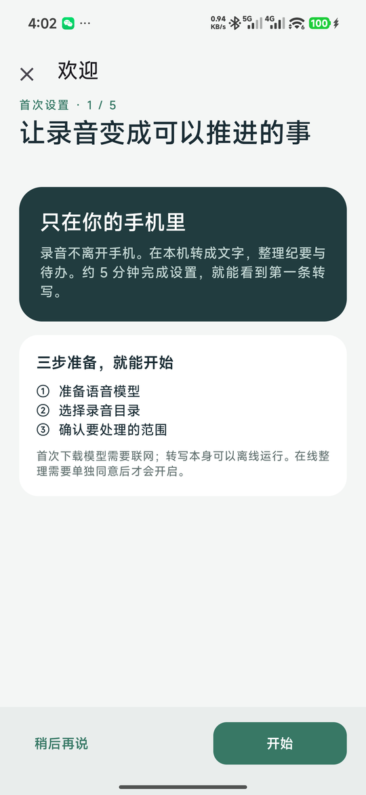
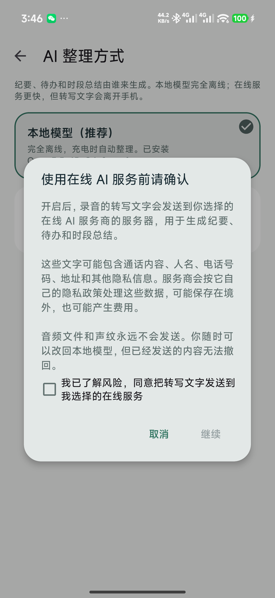
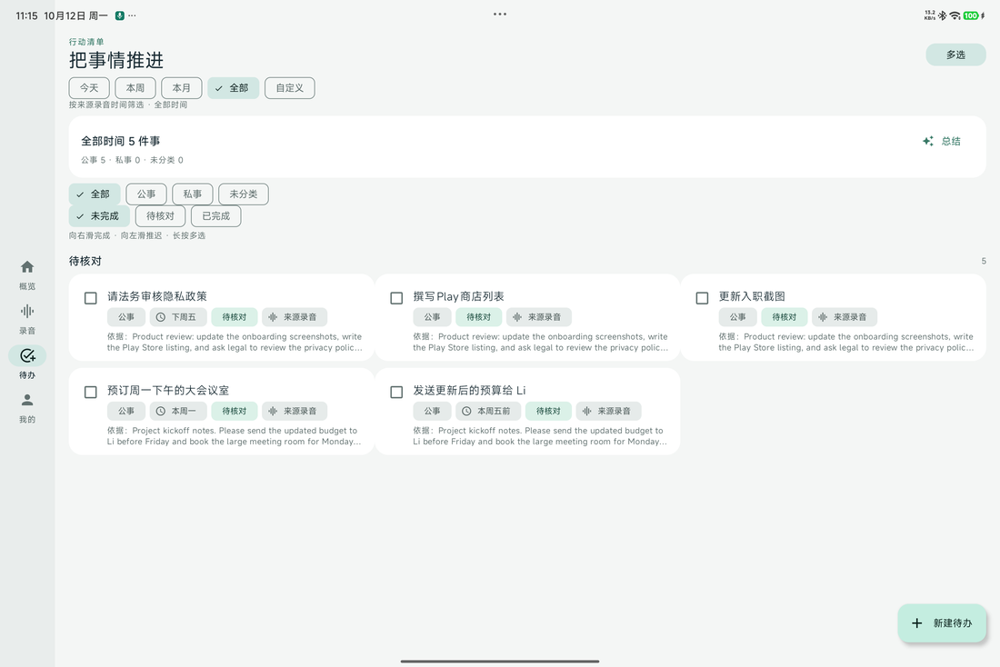

# 录音助手 Recording Helper

把手机上的通话和会议录音，在手机本机变成可核对的文字、纪要和待办。
不需要账号，不需要服务器，音频不离开手机。想在多台设备上看同一份待办时，可以自己部署一个只同步文字的小服务。

<p align="center">
  
  
  
  
</p>
<p align="center">
  
  
  
  
</p>
<p align="center">
  
</p>

## 它做什么

1. **首次打开有向导**：下载或导入模型、授权录音来源、选择处理范围，然后看着第一批录音被逐条转写，文字实时出现。
2. **自动读取系统录音**：授权读取音频后，新的通话 / 会议录音会自动进入队列。处理哪些历史录音由你第一次明确选择。
3. **本机转文字**：SenseVoice-Small 在手机上运行，支持 CPU 与联发科 / 高通 NPU。可选的声纹模型能区分说话人。
4. **纪要和待办**：默认由本机的 Qwen3.5-4B（GGUF）整理，每条待办都附带原文句子作为依据，并标注公事或私事。也可以在阅读风险告知后改用在线 AI 服务（OpenAI、Anthropic、DeepSeek、阿里云百炼、智谱、Moonshot、Gemini，或任何 OpenAI / Anthropic 兼容接口）。
5. **待办面板**：按时段筛选，一眼看到这周有多少事、公事私事各几件、哪些逾期；AI 给出时段总结和建议先做的三件；滑动完成或推迟，长按批量处理。
6. **应用内录音**：边录边出分段文字；录入自己的声纹后，能标出哪些话是你说的。
7. **跨录音认出对方**：电话里通常只有你和另一个人，以你的声纹为锚点，多段通话里就能找出同一个对方，试听确认后命名入库。
8. **可选多设备同步**：自托管的 Node.js 服务只接收文字、纪要和待办，浏览器看板随时查看；删除也会同步。

完整功能清单与状态见 [docs/FEATURES.md](docs/FEATURES.md)。

## 安装

- 下载 [Releases](../../releases) 中的 APK（arm64，Android 8.0 以上；`snapdragon` 版额外包含高通 NPU 运行库）。
- 首次打开会进入向导：从推荐来源下载模型（或本地导入）→ 授权录音来源 → 选择处理范围 → 看着第一批录音被转写。
- 模型文件的来源、哈希与转换方法见 [docs/MODELS.md](docs/MODELS.md)。安装包不内置模型权重，向导会从 Release `models-v1` 的清单下载并校验。
- 上架到 Google Play、国内应用商店、App Store 与鸿蒙的前置条件见 [docs/PUBLISHING.md](docs/PUBLISHING.md)。
- 扩展到英、日、韩、法、德、西、葡、阿等语言的转写模型选型与架构见 [docs/I18N.md](docs/I18N.md)。
- 折叠屏、三折与平板的布局规则（宽度四档、侧栏导航、两列与三列看板、双栏仪表盘、桌面模式录音）见 [docs/FOLDABLE.md](docs/FOLDABLE.md)。

已在 Redmi（HyperOS 16）与 OPPO Find X9 Pro（ColorOS 17）真机验证。HONOR / vivo 已内置候选录音路径，尚未真机验证；任何机型都可以通过授权实际目录使用。

## 多设备同步（可选）

```sh
export RH_TOKEN="$(node -e "console.log(require('crypto').randomBytes(24).toString('base64url'))")"
node server/index.js            # 监听 127.0.0.1:8788，前面放一个 HTTPS 反向代理
```

手机端「设置 → 多设备同步」填入 HTTPS 地址和密钥。Docker、nginx、Caddy、systemd 模板在 `deploy/`，细节见 [server/README.md](server/README.md)。

## 构建

Android：JDK 17、Android SDK 35、Gradle 8.10.2。

```sh
cd app-android
gradle testStandardDebugUnitTest assembleStandardDebug
```

有签名配置（本地 `key.properties`，不入库）时可 `assembleStandardRelease`。仪器测试见 `app/src/androidTest`，使用合成语音，不会打开麦克风或读取私人录音。

服务端：Node.js 24，零依赖。

```sh
node --test server/test/*.test.js
```

## 目录

| 路径 | 内容 |
| --- | --- |
| `app-android/` | Android 应用（Kotlin，原生界面） |
| `server/` | 同步服务与浏览器看板 |
| `deploy/` | 部署模板与模型托管说明 |
| `tools/` | 模型导出脚本、测试语音生成 |
| `docs/` | 功能清单、架构、模型说明、上架流程、多语言架构 |

## 隐私与边界

- 录音、转写、纪要、待办、声纹全部保存在应用私有目录；只有明确开启同步后，文字才会发送到你自己的服务器。
- 声纹匹配是实验性的相似度提示，不是身份认证。
- AI 生成的纪要和待办是建议，执行前请核对原文；原始转写始终保留。
- 预编译的本地 LLM 库要求 arm64 且支持 dotprod / i8mm；更老的芯片需要重新编译 `app-android/native/`。

## 许可

代码以 [Apache License 2.0](LICENSE) 发布。第三方组件与许可见 `app-android/native/`；模型权重由用户自行获取，须遵守各模型的许可条款。
